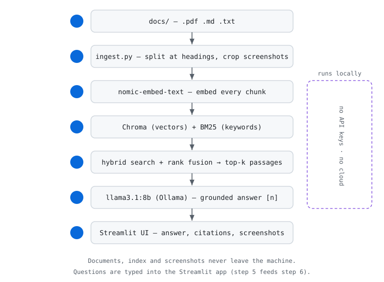

# Local Document Assistant (RAG with Ollama)

A fully local question-answering assistant for your documents. Point it at any set of PDF, Markdown
or text files and it answers questions **only from those documents**, citing the file, page and
section it used, and showing the screenshots that belong to that section of the PDF. It was built
and tested on Teamcenter / CAD user guides, but the interface is document-agnostic: change the
files, rebuild the index, and it works the same.

Everything runs on your machine with [Ollama](https://ollama.com): no API keys, no cloud, and your
documents never leave the computer.



## Features

- **Grounded answers**: the model is told to answer only from retrieved passages and to reply
  "I don't know" otherwise. Unanswered questions are logged to `unanswered.jsonl`, which shows where
  the documentation has gaps.
- **Hybrid retrieval**: vector search (Chroma + `nomic-embed-text`) and BM25 keyword search, merged
  with reciprocal rank fusion. Exact terms like "Excel Round Trip" and fuzzy phrasing both work.
- **Citations**: every answer lists its sources as file, page and section heading.
- **Per-topic screenshots**: images are cut out of the PDF one by one and attached to the section they
  sit under (by their position on the page), so a page with two topics doesn't show the wrong pictures.
- **Simple, responsive UI**: one centred chat screen with a settings popover, so the same interface
  fits any document set (no per-project configuration).
- **Built-in evaluation**: `eval.py` measures accuracy on your own question set, compares models, and
  shows what hybrid search adds. Current numbers are in [Evaluation](#evaluation).
- **Small talk**: greetings and thanks are answered instantly without calling the model.

## Quick start

Requires Python 3.10+ and [Ollama](https://ollama.com).

```
ollama pull nomic-embed-text
ollama pull llama3.1:8b            # or llama3.2:3b on an 8 GB machine
pip install -r requirements.txt

python ingest.py --docs sample_docs   # try it with the bundled fictional documents
streamlit run app.py
```

On Windows use `py` instead of `python` (for example `py -m streamlit run app.py`).

### Use your own documents

1. Put `.pdf`, `.md` or `.txt` files in `docs/` (this folder is git-ignored, so they stay private).
2. Run `python ingest.py`, then `streamlit run app.py`. Re-run `ingest.py` after adding or changing files.

Screenshots need the PDF itself. If a text export (`Manual.pdf.txt`) sits next to `Manual.pdf`, only the
PDF is indexed. Scanned PDFs without selectable text are skipped (they would need OCR).

### Sample documents

`sample_docs/` holds three invented documents (company "Fabrikam Industries", fictional people and
procedures) so the project can be tried end to end without any real data. Regenerate them with
`python tools/generate_sample_docs.py` (needs Pillow, see `requirements-dev.txt`).

## How it works

1. `ingest.py` reads every `.pdf` / `.md` / `.txt` in `docs/`, splits the text at headings, and crops
   each screenshot out of its PDF page.
2. Chunks are embedded with `nomic-embed-text` and stored in Chroma; the same chunks feed a BM25 index.
3. A question is embedded and searched both ways; the two rankings are fused (reciprocal rank fusion)
   and the top passages are passed to the local LLM, which answers with `[n]` citations.
4. Streamlit shows the answer, the cited file/page/section, and the screenshots of the cited sections.

## Evaluation

Write your own questions in `eval/questions.json` (see `eval/questions.example.json` for the format), then:

```
python eval.py                                   # accuracy and average answer time
python eval.py --no-hybrid                       # vector-only, to measure what hybrid search adds
python eval.py --models llama3.1:8b qwen2.5:7b   # compare models
```

A question passes if the answer contains all its keywords. Questions marked `"unanswerable": true`
pass only if the assistant says it doesn't know.

Results on the 14 bundled questions (12 answerable + 2 unanswerable), on a CPU with an 8B model:

| Setup | Accuracy | Avg. time |
|---|---|---|
| llama3.1:8b, vector only | 14/14 (100%) | 1.6 s |
| llama3.1:8b, hybrid | 14/14 (100%) | 1.5 s |

Both reach 100% on this small set. Hybrid search is the default because it also matches exact
terminology (for example "Excel Round Trip") that embeddings alone can rank lower — which matters
more as the collection of documents grows.

## Tests

The tests need no Ollama (embeddings and the LLM are replaced by stand-ins) and run in under a second:

```
pip install -r requirements-dev.txt
python -m pytest
```

## Project layout

| Path | Purpose |
|---|---|
| `rag.py` | Ingestion, chunking, hybrid retrieval, answering, citations |
| `app.py` | Streamlit chat interface |
| `ingest.py` | Builds the index from a folder of documents (`--docs`) |
| `eval.py` | Benchmark runner |
| `eval/questions.json` | Question set used by `eval.py` |
| `sample_docs/` | Fictional documents for trying the project |
| `tools/generate_sample_docs.py` | Regenerates the sample documents |
| `tests/` | Unit and pipeline tests |
| `assets/` | Diagram used in this README |

## Limitations

- Small local models follow instructions less reliably than hosted ones. Check the sources panel, and
  measure with `eval.py`.
- Image-to-topic matching is based on layout (each image belongs to the nearest heading above it).
  Unusual layouts, such as a screenshot placed before its heading, can attach it to the previous topic.
- On a CPU, an 8B model takes several seconds per answer (faster once the model is loaded).
- Plain text only: tables inside PDFs are read as text lines.

## Privacy and data

Your documents, the generated index (`chroma_db/`), the cropped screenshots (`images/`) and
`unanswered.jsonl` are all git-ignored. Don't commit internal manuals, and don't publish vendor
documentation you aren't allowed to redistribute. The files in `sample_docs/` are fictional and safe
to commit.

## License

MIT. See [LICENSE](LICENSE).
